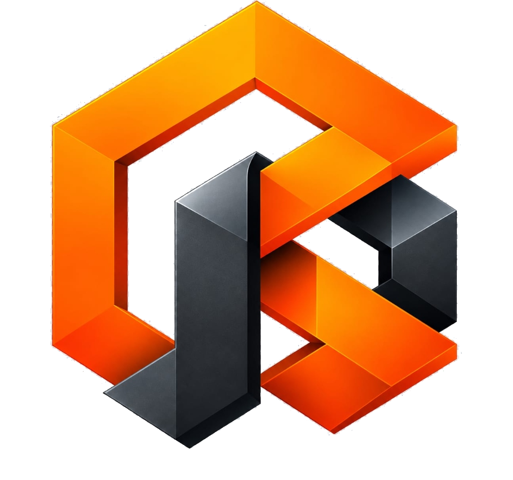

<p align="center">
  
</p>

<h1 align="center">KYRON</h1>

<h3 align="center">Knowledge · Your · Reasoning · Orchestration · Network</h3>

<p align="center">
  <strong>Intelligence, Unleashed.</strong>
</p>

<p align="center">
  KYRON is an AI Agent Skill Marketplace being built to connect skill creators, users, and AI agents through a unified platform for skill discovery, publishing, acquisition, security, and execution.
</p>

<p align="center">
  <a href="#project-status"></a>
  <a href="#license"></a>
</p>

---

## Project Status

> [!IMPORTANT]
> **Status: Building · Pre-alpha**
>
> KYRON is currently in its early building stage. Product discovery, requirements definition, architecture planning, and implementation preparation are underway. The complete marketplace is not yet finished or production-ready.
> 
> Planned capabilities are clearly distinguished from verified foundation modules throughout this documentation.

---

## Table of Contents

- [About KYRON](#about-kyron)
- [Vision and Mission](#vision-and-mission)
- [The Problem](#the-problem)
- [Our Solution](#our-solution)
- [Core Features](#core-features)
- [Platform Modules](#platform-modules)
  - [1. Public Website and Marketplace](#1-public-website-and-marketplace)
  - [2. Creator Studio](#2-creator-studio)
  - [3. Buyer Accounts and Commerce](#3-buyer-accounts-and-commerce)
  - [4. KYRON MCP Hub](#4-kyron-mcp-hub)
  - [5. Trust, Security and Administration](#5-trust-security-and-administration)
- [How KYRON Works](#how-kyron-works)
  - [Creator Journey](#creator-journey)
  - [Buyer Journey](#buyer-journey)
  - [MCP and Agent Journey](#mcp-and-agent-journey)
  - [Security Workflow](#security-workflow)
- [User Roles](#user-roles)
- [Technology Stack](#technology-stack)
- [Architecture Overview](#architecture-overview)
- [Security and Trust](#security-and-trust)
- [Development Roadmap](#development-roadmap)
- [Getting Started](#getting-started)
- [Repository Structure](#repository-structure)
- [Contributing](#contributing)
- [Security Reporting](#security-reporting)
- [License](#license)
- [Acknowledgements](#acknowledgements)

---

## About KYRON

**KYRON** (**Knowledge · Your · Reasoning · Orchestration · Network**) is a unified marketplace and runtime gateway designed specifically for reusable AI agent skills. 

Modern autonomous agents require specialized instructions, API bridges, domain rules, and workflow definitions to perform complex real-world tasks. Today, these capabilities exist as fragmented snippets, unverified scripts, and scattered configuration files across the web.

KYRON addresses this gap by creating an integrated platform where:

- **Users** can discover curated, verified skills tailored for specific reasoning and operational tasks.
- **Creators** can publish, version, and monetize reusable skill packages with built-in security audits.
- **Buyers** can acquire free and premium skills with transparent licensing and entitlement tracking.
- **AI Agents** can autonomously discover, inspect, and execute authorized capabilities via standard Model Context Protocol (MCP) endpoints.
- **Administrators** can uphold rigorous platform trust, safety, and ecosystem standards.

By bridging human-facing marketplace commerce with machine-facing protocol execution, KYRON serves as the foundational exchange for agentic software.

---

## Vision and Mission

### Vision

Make reusable AI capabilities easier to discover, trust, distribute, and use across compatible AI agents worldwide.

### Mission

Build a unified ecosystem where creators can publish valuable AI skills, users can discover and acquire them with confidence, and compatible agents can access authorized capabilities through standardized, secure interfaces.

---

## The Problem

The rapid proliferation of agentic AI systems has revealed several structural challenges in skill distribution:

1. **Discovery Fragmentation**: Reusable agent skills, tools, and prompts are scattered across private repositories, chat logs, and unstructured forums without standardized metadata or classification.
2. **Opacity & Security Risks**: Users and autonomous agents lack verifiable insight into what an imported skill actually executes—such as unauthorized network calls, dangerous filesystem mutations, or prompt-injection vulnerabilities.
3. **Absence of Creator Incentives**: Skilled developers lack a dedicated marketplace infrastructure to package, license, version, and monetize their specialized workflows.
4. **Friction in Entitlement & Updates**: Distributing updates, managing license keys, and revoking deprecated skills require manual, error-prone coordination.
5. **Incompatible Agent Interfaces**: Autonomous runtimes need uniform protocol boundaries (such as MCP) to dynamically query tool schemas, verify user purchase approval, and invoke playbooks safely.

---

## Our Solution

KYRON resolves these challenges through five connected product modules designed to support the entire skill lifecycle:

```text
┌────────────────────────────────────────────────────────────────────────┐
│                        KYRON Ecosystem Architecture                    │
└────────────────────────────────────────────────────────────────────────┘

 [1. Public Marketplace] ─── Discover & Inspect Skills ───► [3. Buyer Accounts & Commerce]
           │                                                               │
     Publishes To                                                    Entitlements
           ▼                                                               ▼
   [2. Creator Studio]   ─── Automated AST Audit ───► [5. Trust, Security & Admin]
                                                                   │
                                                            Verified Access
                                                                   ▼
                                                          [4. KYRON MCP Hub]
                                                                   ▲
                                                       Compatible AI Agents
                                                    (Claude, Cursor, Antigravity)
```

1. **Public Website and Marketplace**: High-density discovery catalog with faceted search, category filtering, transparent security scorecards, and deal promotions.
2. **Creator Studio**: Developer workbench for packaging `SKILL.md` bundles, previewing AST threat scans, configuring license pricing, and analyzing distribution metrics.
3. **Buyer Accounts and Commerce**: Seamless account management, 1-click free installations, wallet credit purchases, cryptographic license keys, and library management.
4. **KYRON MCP Hub**: Direct Model Context Protocol endpoint allowing compatible AI agents to autonomously list, inspect, and invoke authorized skills via JSON-RPC 2.0 streaming.
5. **Trust, Security and Administration**: Continuous static AST scanning, heuristic threat detection, quarantine package stores, and administrative moderation queues.

---

## Core Features

### Marketplace and Discovery *(Planned & Foundation)*
- **Curated Skill Catalog**: Multi-category registry spanning Software Engineering, DevOps, Data Science, Security, and Creative workflows.
- **Faceted Search & Filters**: Instant filtering by tags, execution runtime, compatibility rating, and community feedback.
- **Rich Skill Detail Views**: Comprehensive playbook specifications, session preview logs, package file trees, and author credentials.
- **Transparent Licensing & Pricing**: Upfront visibility into free open-access versus premium commercial credit tiers.
- **Community Ratings & Votes**: Verified user reviews, net upvotes, and bookmarking for price-drop notifications.

### Creator Tools *(Planned & Foundation)*
- **Streamlined Creator Intake**: Intuitive submission pipeline for uploading and configuring skill packages.
- **Automated SKILL.md Validation**: Instant linting of YAML frontmatter, input parameters, and required metadata fields.
- **8-Point AST Security Scanning**: Pre-flight checks evaluating prompt injections, shell escapes, eval patterns, and exfiltration attempts.
- **Dynamic Revenue Modeling**: Real-time earnings calculators modeling platform revenue shares and distribution tiers.
- **Version & Package Management**: Immutable release tagging, deprecation controls, and changelog management.

### Buyer Experience *(Planned & Foundation)*
- **Unified Account Portal**: Fast onboarding with session persistence and authenticated credentials.
- **1-Click Free Skill Activation**: Immediate library addition for community and open-source playbooks.
- **Credit Balance & Checkout**: Predictable credit billing avoiding friction for recurrent micro-transactions.
- **Cryptographic License Keys**: Unique, verifiable license identifiers generated upon entitlement purchase.
- **Buyer Library**: Centralized repository of all acquired skills, active package downloads, and MCP connection configs.

### MCP and Agent Integration *(Planned & Foundation)*
- **Native MCP Protocol Support**: Compliant with Anthropic Model Context Protocol (v2024-11-05) specs over JSON-RPC 2.0.
- **Autonomous Tool Schemas**: Pre-registered tools (`search_skills`, `get_skill_details`, `install_skill`, `get_my_skills`, `execute_skill_workflow`).
- **Policy-Gated Entitlement Checks**: Strict runtime verification ensuring agents only access skills the user owns or approves.
- **Streaming Result Delivery**: Standardized response envelopes delivering structured findings back into agent reasoning loops.

### Trust and Administration *(Planned & Foundation)*
- **Zero-Tolerance Automated Gates**: Immediate rejection of packages exhibiting known malicious patterns or malformed syntax.
- **Permanent Audit Ledger**: Granular recording of rule-by-rule scan findings linked to published skill versions.
- **Isolated Package Quarantine**: Skill package contents remain locked and inaccessible until explicit entitlement validation.
- **Abuse Reporting & Moderation**: Administrative workflows for takedowns, dispute resolution, and security flagging.

---

## Platform Modules

### 1. Public Website and Marketplace
The public front-door of KYRON enables visitors and developers to browse the ecosystem without initial authentication hurdles. Users can explore categorized skill listings, inspect detailed usage playbooks, verify security ratings, and review compatibility prerequisites before initiating an acquisition.

### 2. Creator Studio
The dedicated workspace for skill developers. Creators input package metadata, author comprehensive markdown instructions, define required runtime tools, and set commercial terms. The studio provides instant diagnostic feedback from the automated threat scanner, ensuring packages meet ecosystem standards before submission.

### 3. Buyer Accounts and Commerce
Manages user identity, account balances, and purchase records. Handles both frictionless zero-cost community skill installs and commercial credit deductions. Emits cryptographically verifiable license keys and maintains the user's permanent entitlement library across client sessions.

### 4. KYRON MCP Hub
The machine interface connecting KYRON to the external AI ecosystem. Runtimes such as Claude Desktop, Cursor, and Google Antigravity connect via MCP endpoints (`/mcp` and `/api/mcp`). The hub validates client identity, verifies purchase status, and dynamically serves tool schemas and playbook instructions directly to the agent's context window.

### 5. Trust, Security and Administration
The platform's safety engine. Enforces automated syntax and heuristic scanning across all submissions, prevents untrusted package execution, isolates quarantined code, and provides operators with administrative moderation tools to maintain ecosystem integrity.

---

## How KYRON Works

### Creator Journey

```text
[Creator]
   │
   ├─► 1. Register & Access Creator Studio
   ├─► 2. Upload SKILL.md Package & Set Listing Parameters
   ├─► 3. Automated Validation & 8-Point AST Security Scanning
   │         │
   │         ├── [Scan Fails] ──► Return Actionable Diagnostics to Creator
   │         │
   │         └── [Scan Passes] ─► Package Stored in Entitlement Vault
   │
   └─► 4. Listing Published to Public Catalog with Security Grade
```

### Buyer Journey

```text
[Buyer]
   │
   ├─► 1. Browse Catalog, Filter by Category, Search by Need
   ├─► 2. Review Skill Details, Preview Session & Inspect Audit Report
   ├─► 3. Select Acquisition Path:
   │         │
   │         ├── Free Skill ──► 1-Click Installation
   │         │
   │         └── Paid Skill ──► Check Credit Balance ──► Deduct & Mint License Key
   │
   └─► 4. Skill Added to Library with MCP Snippet Ready for Agent Use
```

### MCP and Agent Journey

```text
[AI Agent Runtime] (Claude, Cursor, Antigravity)
   │
   ├─► 1. Connects to KYRON MCP Gateway (JSON-RPC 2.0)
   ├─► 2. Discovers Tools: tools/list
   ├─► 3. Autonomous Discovery: tools/call search_skills
   ├─► 4. Installation Request: tools/call install_skill
   │         │
   │         └─► Gateway Validates Identity & Entitlement Record
   │
   ├─► 5. Playbook Retrieval / Workflow Trigger: tools/call execute_skill_workflow
   └─► 6. Structured Execution Result Returned into Agent Context
```

### Security Workflow

Every skill submission undergoes an exhaustive 8-point automated static and heuristic analysis before entering the marketplace catalog:
1. **Frontmatter Validation**: Strict verification of YAML headers, mandatory name/version declarations, and schema syntax.
2. **Prompt Injection Defense**: Detection of adversarial role-escape patterns, system-prompt override attempts, and jailbreak tokens.
3. **Filesystem Mutation Guard**: Static detection of destructive disk commands (`rm -rf`, recursive formatting).
4. **Credential Exfiltration Audit**: Flagging attempts to harvest environment variables, API secrets, or private SSH keys.
5. **Reverse Shell Detection**: Identification of unauthorized socket connections, netcat bindings, or raw pipe-to-shell constructs.
6. **Telemetry & Network Audit**: Detection of suspicious phone-home requests or unlisted third-party analytics endpoints.
7. **Obfuscation Detection**: Flagging dynamic code execution (`eval`, `Function()`, hex-encoded payloads).
8. **Syntax & Playbook Sanity**: Structural validation ensuring runnable commands adhere to platform standards.

*Note: Automated static scanning is a foundational filter and does not replace defense-in-depth runtime isolation.*

---

## User Roles

| Role | Primary Activities | System Boundaries |
| :--- | :--- | :--- |
| **Visitor** | Browses public marketplace, searches listings, evaluates security badges and reviews. | Read-only public endpoints; no session required. |
| **Registered Buyer** | Manages personal library, acquires free/paid skills, maintains credit balance, generates license keys. | Authenticated customer routes; private library data access. |
| **Creator / Seller** | Authors and submits skill packages, configures pricing, monitors sales analytics and distribution. | Authenticated creator portal; package upload and management endpoints. |
| **AI Agent / MCP Client** | Autonomously searches skills, queries schemas, verifies entitlements, and loads playbooks into reasoning contexts. | JSON-RPC 2.0 streaming protocol; scoped token authentication. |
| **Administrator** | Oversees platform safety, manages moderation queues, handles abuse reports, audits security logs. | Strict role-based administrative boundaries; comprehensive audit access. |

---

## Technology Stack

The proposed initial architecture is designed for performance, developer velocity, and robust security:

| Layer | Proposed Technology | Architectural Role |
| :--- | :--- | :--- |
| **Frontend** | React 19, TypeScript, Tailwind CSS, Vite | Responsive SPA client with sub-second navigation and high-density technical layouts. |
| **Backend** | Node.js, Express, TypeScript | High-throughput REST API gateway and streaming JSON-RPC Model Context Protocol server. |
| **Database** | PostgreSQL | Enterprise relational storage with ACID transactions for financial ledgers and entitlements. |
| **Data Access** | Prisma ORM | Type-safe schema migrations, strict relation enforcement, and query optimization. |
| **Authentication** | Secure Sessions / JWT with Bcrypt | Stateless cryptographic identity tokens with role-based claim enforcement. |
| **File Storage** | S3-Compatible Object Storage | Durable, encrypted cloud storage for versioned skill package archives. |
| **Agent Protocol** | Official Model Context Protocol (MCP) SDK | Standardized agent-to-tool communication protocol for interoperable AI runtimes. |
| **Testing** | Node.js Test Runner, Playwright E2E | Unit test coverage, integration journey verification, and browser regression testing. |
| **Hosting & CI/CD** | Cloud Container Platform & Automated CI | Automated linting, test suite execution, and reproducible production container deployments. |

*Technologies reflect the proposed product stack and will be integrated incrementally as development advances.*

---

## Architecture Overview

KYRON is architected as an integrated modular platform separating human interaction, machine protocol traffic, business logic, and security isolation:

```text
┌────────────────────────────────────────────────────────────────────────┐
│                              Clients Tier                              │
│    Web Browsers (Desktop & Mobile)     │    AI Agent Runtimes (MCP)    │
└───────────────────────────────────┬────────────────────────────────────┘
                                    │ HTTP / JSON-RPC
                                    ▼
┌────────────────────────────────────────────────────────────────────────┐
│                        Edge Gateway & Middleware                       │
│    Reverse Proxy  ·  CORS Policy  ·  JWT Guard  ·  Rate Limiting       │
└───────────────────────────────────┬────────────────────────────────────┘
                                    │
       ┌────────────────────────────┼────────────────────────────┐
       ▼                            ▼                            ▼
┌──────────────┐             ┌──────────────┐             ┌──────────────┐
│  Marketplace │             │  Commercial  │             │   Model      │
│  Discovery   │             │  Ledger &    │             │   Context    │
│  & Catalog   │             │  Entitlement │             │   Protocol   │
│  Services    │             │  Services    │             │   Gateway    │
└──────┬───────┘             └──────┬───────┘             └──────┬───────┘
       │                            │                            │
       └────────────────────────────┼────────────────────────────┘
                                    ▼
┌────────────────────────────────────────────────────────────────────────┐
│                 Security Threat & AST Inspection Engine                │
│    YAML Linter  ·  Prompt Guard  ·  Heuristic Rules  ·  Audit Ledger   │
└───────────────────────────────────┬────────────────────────────────────┘
                                    │
       ┌────────────────────────────┴────────────────────────────┐
       ▼                                                         ▼
┌─────────────────────────────────┐           ┌──────────────────────────┐
│       Relational Database       │           │  Encrypted Package Store │
│  Profiles · Skills · Purchases  │           │  Isolated Playbook Files │
└─────────────────────────────────┘           └──────────────────────────┘
```

1. **Presentation Layer**: A responsive React SPA provides discovery catalogs, creator workspaces, and interactive MCP sandboxes.
2. **API & Protocol Gateway**: Express server handling REST endpoints for web interactions alongside JSON-RPC 2.0 streaming transports for autonomous agent tool invocations.
3. **Core Domain Services**: Modular services governing catalog search, package versioning, atomic credit deductions, and cryptographic license generation.
4. **Security Threat Engine**: Pure static AST parser and heuristic analysis pipeline enforcing 8 zero-tolerance rules on all incoming playbooks prior to catalog indexing.
5. **Persistence Tier**: Relational database managing users, listings, purchases, reviews, and audit logs with strict foreign key constraints, paired with isolated object storage for raw package bundles.

---

## Security and Trust

Security is central to KYRON's product philosophy. The platform is designed around strict operational principles:

- **Untrusted Input by Default**: All uploaded skill packages and tool arguments are treated as potentially adversarial input.
- **Pre-Publication AST Scanning**: Code and instructions are analyzed statically before being indexed in the public catalog.
- **Server-Side Entitlement Authority**: Client applications cannot grant access; all purchases and skill activations require authoritative server validation.
- **Zero-Secret Client Exposure**: API credentials, database keys, and private tokens remain strictly within managed server-side environments.
- **Stateless Cryptographic Sessions**: User identity is verified via signed tokens with configurable expiration and secure storage.
- **Rate-Limiting & Abuse Prevention**: Sensitive authentication and tool-execution endpoints are rate-limited against denial-of-service and brute-force vectors.
- **Input Validation & Sanitization**: Strict schemas validate all payload inputs across both REST and JSON-RPC routes.
- **Immutable Security Audit Trails**: Scan verdicts and diagnostic findings are permanently recorded in audit logs.
- **Access Isolation**: Raw package contents remain quarantined and accessible only via verified entitlement tokens.
- **No Unrestricted Execution**: KYRON does not execute unverified third-party binaries with unrestricted server privileges.
- **Least-Privilege Operation**: All service boundaries and database connections operate with minimal required access rights.
- **Continuous Security Evolution**: Security rules and heuristic patterns are continually refined as agentic attack surfaces evolve.

---

## Development Roadmap

KYRON is being constructed through a disciplined, staged development plan:

```text
[Phase 0] ──► [Phase 1] ──► [Phase 2] ──► [Phase 3] ──► [Phase 4] ──► [Phase 5] ──► [Phase 6]
Discovery     Foundation   Marketplace   Creator Studio   Commerce     MCP Hub       Launch
```

### Phase 0 — Product Discovery & Specifications *(Active)*
- [x] Product definition and market requirements documentation.
- [x] Page, screen, and interactive component inventory.
- [x] End-to-end user journeys and state machine specifications.
- [x] Technical architecture blueprint and domain service boundaries.

### Phase 1 — Platform Foundation *(In Progress)*
- [x] Repository initialization, project branding, and README establishment.
- [ ] Database schema migrations and relational models.
- [ ] Authentication, session management, and role-based guards.
- [ ] Structured logging, telemetry, and test runner infrastructure.

### Phase 2 — Marketplace Discovery *(Planned)*
- [ ] Public landing page and category navigation.
- [ ] Full catalog search with faceted attribute filtering.
- [ ] Skill detail specifications, code preview drawers, and security scorecards.
- [ ] Community upvoting, reviews, and bookmarking alerts.

### Phase 3 — Creator Studio *(Planned)*
- [ ] Creator onboarding and verified profile setup.
- [ ] Drag-and-drop skill package uploader with instant YAML linting.
- [ ] Automated 8-point AST threat detection engine integration.
- [ ] Creator analytics dashboard modeling 70% distribution revenue.

### Phase 4 — Buyer Commerce & Entitlements *(Planned)*
- [ ] Frictionless 1-click free skill activation.
- [ ] Credit balance wallet, package top-ups, and checkout approval.
- [ ] Atomic purchase transactions and cryptographic license key minting.
- [ ] Buyer library dashboard with instant package tree retrieval.

### Phase 5 — Autonomous MCP Hub *(Planned)*
- [ ] JSON-RPC 2.0 streaming transport on `/mcp` and `/api/mcp`.
- [ ] Autonomous tool registry (`search`, `details`, `install`, `library`, `execute`).
- [ ] Entitlement verification middleware for agent tool calls.
- [ ] Live interactive MCP testbed with copyable configuration snippets.

### Phase 6 — Trust, Integration & Ecosystem Launch *(Planned)*
- [ ] Administrative moderation queues and listing takedown workflows.
- [ ] End-to-end regression test suite across desktop and mobile viewports.
- [ ] Formal third-party security audit and vulnerability assessment.
- [ ] Production deployment, monitoring, and developer community launch.

---

## Getting Started

> [!NOTE]
> The project is currently in its pre-alpha planning and setup stage. Application installation and local development instructions will be published here as the implementation foundation becomes available.
>
> Once the core codebase is tagged for initial developer preview, verified prerequisites, installation commands, environment configuration, database setup, and test scripts will be provided.

---

## Repository Structure

The current repository layout organizes the established project assets, technical architecture specifications, and documentation:

```text
KYRON/
├── README.md                           # Master project documentation & landing page
├── assets/
│   ├── logo/
│   │   ├── kyron-logo.svg              # Scalable vector brand emblem
│   │   ├── kyron-logo-transparent.png  # High-resolution transparent PNG emblem
│   │   ├── kyron-logo.png              # Lossless RGB emblem
│   │   ├── kyron-logo.jpg              # Master original image asset
│   │   └── README.md                   # Brand guidelines & color specifications
│   └── screenshots/
│       └── README.md                   # Verified visual evidence policy
└── docs/
    ├── README.md                       # Architecture & documentation directory index
    ├── TECHNICAL_ARCHITECTURE.md       # Foundational architecture specification
    └── kyron-architecture/             # Verified system architecture specifications
        ├── COMPONENT_INVENTORY.md      # Comprehensive component mappings
        ├── DATA_FLOW_INVENTORY.md      # Protocol & edge execution mappings
        ├── VALIDATION_REPORT.md        # Formal verification audit & test proofs
        └── GAP_REPORT.md               # Implementation boundary & roadmap analysis
```

---

## Contributing

Contributions, technical feedback, and architectural discussions are welcome as we build KYRON.

Because the project is in **Pre-alpha**, our contribution process focuses on architectural alignment:

1. **Explore the Discussions & Issues**: Review existing issues or open a new discussion to discuss proposed features before writing extensive code.
2. **Branching**: Create focused feature branches from `main` (`feature/issue-description` or `fix/issue-description`).
3. **Commit Conventions**: Use descriptive, conventional commit messages (e.g., `feat:`, `fix:`, `docs:`, `test:`).
4. **Testing**: Ensure all automated lint checks and tests pass before submitting.
5. **Pull Requests**: Submit pull requests with clear explanations of problem context, architectural changes, and validation evidence.

---

## Security Reporting

KYRON is committed to responsible disclosure and proactive security practices:

- If you discover a potential vulnerability or security concern, please report it privately through GitHub's Security Advisories tab or private vulnerability reporting once enabled on this repository.
- **Do not open public GitHub issues for sensitive security vulnerabilities.**
- Please provide detailed steps to reproduce the issue and allow maintainers reasonable time to investigate and address the vulnerability before public disclosure.

---

## License

The open-source or proprietary licensing model for KYRON is currently **To Be Determined (TBD)**. A formal license will be selected and committed prior to public alpha distribution.

---

## Acknowledgements

KYRON builds upon foundational standards and architectural patterns pioneered across the open-source AI and developer tooling ecosystems:

- **Model Context Protocol (MCP)**: The open protocol standard connecting AI agents to real-world tools and data sources.
- **The TypeScript & Node.js Communities**: For empowering high-performance, type-safe full-stack application development.
- **Modern Web Standards**: For enabling responsive, accessible, and high-density technical developer interfaces.

---

<p align="center">
  <strong>KYRON</strong> · Intelligence, Unleashed.
</p>
